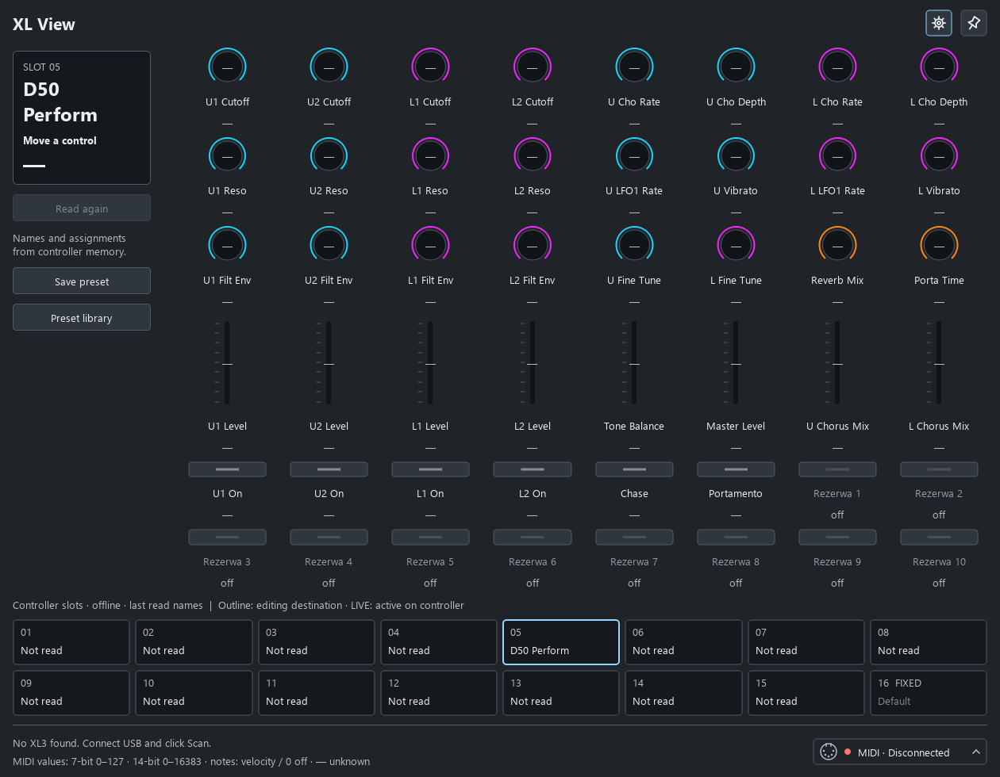

# XL View

**See what every control does. Edit your Launch Control XL 3 without leaving your desktop.**

XL View is an independent Windows companion and Custom Mode editor for the **Novation Launch Control XL 3**. It mirrors the controller's 24 knobs, eight faders and 16 buttons, showing their names, assignments, LED colors and incoming MIDI values.

[Download the latest Windows installer](https://github.com/redemprez/XL-View/releases/latest) · [User guide](docs/USER_GUIDE.md) · [Report a bug](https://github.com/redemprez/XL-View/issues/new?template=bug_report.yml)



*An example mapping loaded offline. Dashes mean no MIDI value has been received.*

## Why XL View?

When switching between instruments and Custom Modes, it is easy to forget what a knob controls. XL View keeps the current mapping visible beside your DAW and makes small changes quick: select a control, change its name, color or MIDI assignment, then send the edit to the controller.

## Features

- **Visual controller layout:** names and assignments in their physical positions, with live incoming MIDI values.
- **Slot overview:** names for editable Custom Modes 1–15, an active-mode indicator and Follow controller enabled by default. Fixed mode 16 is shown as a read-only indicator.
- **Single and multiple control editing:** Ctrl-click to add/remove controls, Shift-click for a range, and an editor panel with copy/paste, undo and change inspection.
- **Send one control or a complete mode:** read-before-write backups and readback verification. A single-control edit is merged into the freshly read mode before sending.
- **Preset library:** save, import/export `.syx`, import from the device, select versions and send a preset to the active slot. Same-name presets are grouped; the five latest versions stay in the library.
- **Resizable window and pin button:** keep the mapping visible above your DAW.
- **Readable labels:** choose a font, 75–200% scale, bold text, text color and optional label backgrounds.
- **Optional changes preview before sending** and MIDI diagnostics in Settings.

## Install

1. Open [Releases](https://github.com/redemprez/XL-View/releases/latest).
2. Download `XL-View-Setup-0.7.0-x64.exe` and run it.
3. Connect your Launch Control XL 3 by USB and open XL View.
4. Use the MIDI status button at the bottom right if you need to select or reconnect a device.

The installer includes Python and Qt; no separate Python installation is required. It installs for the current user without administrator rights. The current release is **unsigned**. SHA-256 checksums are supplied with the release.

**Target:** Windows 10 version 2004 or later / Windows 11, x64. Tested in the author's Windows 11 environment; other machines and Windows on Arm are not yet verified. Older Launch Control XL models are not supported. There is no Android or macOS build.

## A few things to know

- Displayed values are received MIDI data, not guaranteed current plugin values. XL View does not automatically learn a plugin's parameter names or synchronize every DAW parameter.
- Loading a preset does not send it. Selecting a slot in XL View does not switch the hardware's active mode. The slot outline and **LIVE** indicator have different meanings.
- Only Custom Modes **1–15** can be read and edited. Mode **16 Default** is an indicator; its factory assignments are not displayed or editable.
- MIDI port access depends on your Windows driver and other software. If Components, your DAW or another XL View instance holds a required port, close that connection and reconnect. Follow controller needs access to the controller's DAW port.
- Sending one control preserves other assignments by reading, merging and writing the mode; it is not a special hardware single-parameter write command. A failed write may leave a partially changed slot; a local backup is retained.
- Plugin mappings may still require the plugin's or DAW's MIDI Learn. Saving a controller preset does not create those assignments inside your instrument.

See the [user guide](docs/USER_GUIDE.md) for editing, presets, storage and troubleshooting. The original Polish manual is also available: [INSTRUKCJA.txt](INSTRUKCJA.txt).

## Run from source

Use Windows x64 and Python 3.11:

```powershell
python -m venv .venv
.venv\Scripts\python.exe -m pip install -r requirements.txt
.venv\Scripts\python.exe main.py
```

For offline use: `.venv\Scripts\python.exe main.py --offline`.

The application uses **Python, PySide6/Qt and native Windows WinMM MIDI**. See [development and build instructions](docs/DEVELOPMENT.md) for tests, packaging and the source structure.

## Contributing

Bug reports, feature ideas and pull requests are welcome. Please read [CONTRIBUTING.md](CONTRIBUTING.md). Hardware-specific reports are particularly useful; include your Windows version, controller firmware and exact steps.

## License and credits

XL View's original code and artwork are available under the [MIT License](LICENSE), copyright 2026 redemprez. Bundled dependencies retain their own licenses; see [third-party notices](installer/THIRD_PARTY_NOTICES.txt) and [license texts](installer/licenses).

XL View is an independent project, not affiliated with or endorsed by Novation, Focusrite, or the instrument manufacturers shown in example mappings. Their names identify compatible hardware or example instruments. No controller firmware, Components application, or instrument plugins are included.
